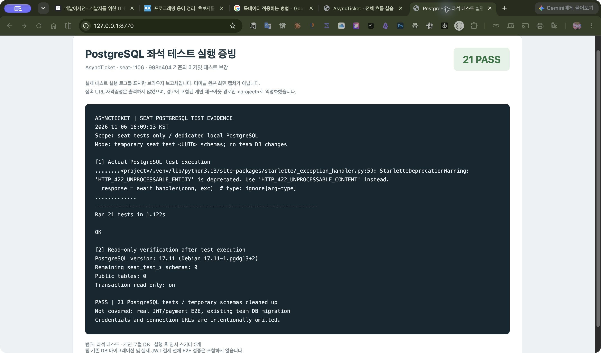

# 좌석 테스트 시나리오

2026-11-06, `seat-1106` 기준. 좌석 테스트만 정리한다. `reservation_items`는 삭제 대상이며 사용하지 않는다.

## 실행 및 검증 범위

```sh
uv run --with httpx --with aiosqlite python -B -m unittest discover -s tests/seat_queries -v
uv run python -B -m unittest discover -s tests -p 'test_seat_*.py' -v
```

- HTTP·SQLite 테스트 29개 = 기존 조회·연결 17개 + 구성 쓰기 12개.
- 도메인·서비스 단위 테스트 16개 = 도메인 12개 + 예매 연결 서비스 4개.
- 실제 좌석 라우터·서비스·저장소와 메모리 SQLite 사용. 쓰기 API 인증은 테스트 판매자로 대체한다.
- Claude Code는 제공 코드 교차검토를 수행했다. 테스트 실행 결과는 Codex가 확인했다.
- 아래 PostgreSQL 추가 검증 절 참고. 실제 JWT 인증·결제 포함 E2E와 팀 기존 DB 보정은 미검증이다. 전체 프로젝트 테스트 통과를 뜻하지 않는다.

## 구성 쓰기: `tests/seat_queries/test_configuration.py` (12개)

| 시나리오 | 기대 응답 및 저장 결과 |
| --- | --- |
| 30,000원 등급 등록 | 201·Location, 등급 1건과 AVAILABLE 좌석 2건, reserv_id NULL 저장 |
| 0원 등급 등록 | 201, 0원 그대로 저장 |
| 가격 49,999원 → 0원 수정 | 각 200, 가격 반영·등급/좌석 구성 유지 |
| 다른 판매자의 등록 | 403 PERMISSION_DENIED, 등급·좌석 생성 없음 |
| 다른 판매자의 가격 수정 | 403 PERMISSION_DENIED, 기존 가격·구성 유지 |
| 판매 시작 후 등록 | 409 SEAT_SALE_STARTED, 기존 데이터 유지 |
| 판매 시작 후 가격 수정 | 409 SEAT_SALE_STARTED, 기존 데이터 유지 |
| 같은 회차의 기존 등급 재등록 | 409 CONFLICT, 신규 좌석명을 보내 등급 중복 검사 분리 |
| 같은 회차의 기존 좌석명 재사용 | 409 CONFLICT, 다른 등급으로 요청해 좌석명 중복 검사 분리 |
| 한 요청 안의 중복 좌석명 | 422 REQUEST_VALIDATION_ERROR, 기존 데이터 유지 |
| 등급·첫 좌석 flush 후 좌석 저장 강제 실패 | 500, 신규 등급·좌석 전체 rollback·기존 데이터 보존·재시도 201 |
| 등급·좌석 저장 후 commit 직전 강제 실패 | 500, 신규 등급·좌석 전체 rollback·기존 데이터 보존·재시도 201 |

실패 주입 테스트는 요청 후에도 세션을 열어 두고 실제 rollback 호출과 트랜잭션 종료를 검사한다. 세션 close의 자동 rollback만으로 통과하지 않게 한다. 실패 지점에 도달했는지도 별도 확인한다. commit 테스트는 commit 메서드 진입 시 예외를 주입하며, 실제 DB commit 중 네트워크 장애나 결과 불명 상황을 재현한 것은 아니다.

## 조회·연결: `tests/seat_queries/test_queries.py` (17개)

| 시나리오 | 확인 내용 |
| --- | --- |
| 미연결 좌석 예매 연결 | 회차·예매·상태 조건 불일치 거절, 정상 연결, 중복 연결 거절, rollback 복구와 호출자 commit 반영 |
| 연결 입력 검증 | 잘못된 ID·동일 상태에 공통 422 예외 |
| 회차별 목록 | 다른 회차 제외, 등급 포함, reserv_id 응답 제외 |
| 좌석 없는 기존 회차 | 200·빈 목록 |
| 없는 회차 | 404 |
| 상세 조회 조건 | 회차와 좌석명을 함께 사용 |
| 슬래시 좌석명 | A/01과 A%2F01 모두 200 |
| 없는 좌석 | 기존 회차 안에서 404 |
| 잘못된 회차 ID | 0·음수·문자열 422 |
| 미설정 데이터 | 등급·가격·좌석명 NULL 보존 |
| DB의 중복 좌석명 | 임의 선택 대신 500 |
| GET의 상태 보존 | 조회 후 좌석 상태·예매 FK 그대로 |
| 등급 저장소 반환 | 도메인 변환, 없는 등급, 미설정 행 처리 |
| OpenAPI 응답 | 공통 성공·실패 스키마 선언 |
| 공통 응답 형식 | 성공·404·422의 code/data/errors 등 확인 |
| 등급 서비스 연결 | 등급 전용 저장소 주입 후 조회 |
| 계층 import | 상위 계층의 infrastructure·SQLAlchemy 직접 import 금지 |

## 단위 테스트 (16개)

`tests/test_seat_domain.py` (12개): 잔여 좌석 계산, 잔여 수량과 같은 요청 허용, 초과 요청 거절·원본 보존, 잘못된 요청 수량, 잘못된 점유 수, 잘못된 ID, 잘못된 수용량·가격, 불완전 구성 생성 거절, 필수 구성 항목 누락, 0원·양수 가격/수용량 경계, 잘못된 등급, 생성 후 직접 값 변경 금지.

`tests/test_seat_assignment.py` (4개): 인자 전달 및 트랜잭션 비소유, 저장소 False일 때 충돌, 양수가 아닌 ID의 저장소 호출 차단, 빈 상태·같은 상태의 저장소 호출 차단.

## 체크리스트

- [x] 등록·가격 수정 성공 및 저장 확인
- [x] 비소유자 등록·가격 수정 차단
- [x] 판매 시작 후 등록·가격 수정 차단
- [x] 중복 등급·좌석명 거절
- [x] 부분 저장·commit 직전 실패 시 전체 rollback
- [x] 슬래시 포함 좌석명 회귀 검사
- [x] 전용 PostgreSQL 좌석 저장·연결·rollback 및 2건·10건 경쟁 검사
- [ ] 실제 JWT·결제·예매 전체 E2E (좌석 테스트와 별도)
- [ ] 예매 서비스 실제 호출 연결과 같은 세션의 최종 commit 확인 (예매 담당)
- [ ] 좌석 상태 의미·전이 규칙 팀 확인
- [ ] PR 이력의 shared·타도메인 변경 담당자 검토
- [ ] 공통 검증 오류 안내 리뷰 처리 (공통 담당)

좌석 연결 함수 준비와 예매 서비스가 실제 호출하는 것은 별도다. reserv_id PK와 최종 예매 commit은 예매가 소유한다. 이 테스트 보강에서는 shared·다른 도메인을 수정하지 않았다.


## 전용 로컬 PostgreSQL 추가 검증 (2026-11-06)

이번 실행 대상은 `asyncticket-seat-local-1106`, `127.0.0.1:5435/asyncticket_seat_local`이다. 비밀번호는 개인 `.env`에만 둔다. 기존 5432 DB나 다른 컨테이너는 사용하지 않는다.

`tests/seat_postgres/test_postgres.py`는 전용 URL을 명시해야 실행된다. asyncpg 드라이버·로컬 호스트만 허용하며 DB 이름에 `_`/`-`로 구분된 `test` 또는 `local` 단어가 없으면 거절한다. 접속 대상을 덮어쓸 수 있는 URL 쿼리도 거절한다. 팀원은 자신의 전용 로컬 DB 주소를 환경 변수로 전달할 수 있다. 테스트마다 UUID 임시 스키마를 만들고 종료 시 해당 스키마만 삭제한다. `public`이나 기존 팀 테이블을 수정하지 않는다. 공연·예매 부모 테이블은 FK·소유권·회차 검사용 최소 픽스처이며 해당 도메인 구현 완료의 근거가 아니다.

환경 변수를 직접 지정한 팀원은 다음 명령을 사용할 수 있다. URL에는 개인 전용 테스트 DB를 지정한다.

```sh
uv run --with httpx --with aiosqlite python -B -m unittest discover -s tests/seat_postgres -v
```

이 환경에서는 개인 `.env`의 URL을 사용해 다음과 같이 실행했다. URL·비밀번호는 출력하지 않는다.

```sh
uv run --with httpx --with aiosqlite python -B - <<'PYTEST'
import os, unittest
from dotenv import dotenv_values
os.environ['ASYNCTICKET_TEST_DATABASE_URL'] = dotenv_values('.env')['DATABASE_URL']
result = unittest.TextTestRunner(verbosity=2).run(
    unittest.defaultTestLoader.discover('tests/seat_postgres')
)
raise SystemExit(not result.wasSuccessful())
PYTEST
```

- PostgreSQL 21개 통과: 구성 쓰기 12개를 실제 PG에서도 실행 + 추가 검사 9개.
- 기존 SQLite 29개 및 단위 16개 재실행 통과. 실행한 테스트 합계 66개이며 SQLite/PG에 같은 시나리오를 반복한 수를 포함한다.
- 실행 후 `public` 테이블 0개, 남은 `seat_test_*` 임시 스키마 0개 확인.

| PostgreSQL 추가 시나리오 | 확인 결과 |
| --- | --- |
| 좌석 FK·NULL 허용 구조 | 등급·회차·예매 참조, reserv_id nullable 확인 |
| 문자열 → 도메인 enum | SeatGrade.S·SeatStatus.AVAILABLE 변환 |
| 존재하지 않는 참조 삽입 | 좌석의 등급/예매 FK 및 등급의 회차 FK 위반 거절 |
| 예매 연결 조건 | 다른 회차·없는 예매·현재 상태 불일치·재연결 거절, 정상 연결 commit |
| 같은 세션 미커밋 예매 | 좌석 연결 가능, rollback 후 예매와 좌석 변경 모두 소멸 |
| 다른 세션 미커밋 예매 | EXISTS에 보이지 않아 좌석 연결 거절 |
| 동시 연결 2건 | 정확히 1건 성공, 나머지 충돌, 최종 승자 FK 유지 |
| 동시 연결 10건 | 정확히 1건 성공, 나머지 충돌, 최종 승자 FK 유지 |
| 등록 → 조회 | 0원·enum 응답 및 슬래시 좌석명 조회 성공 |

### 아직 증명하지 않은 것

- 현재 ORM으로 새로 만든 임시 스키마의 검사다. 기존 팀 DB 스키마·데이터의 정합성이나 마이그레이션 성공을 뜻하지 않는다.
- 경쟁 테스트의 예매 행은 미리 존재한다. 실패한 요청의 예매 생성까지 포함한 전체 예매 트랜잭션·실패 예매 미잔존 검증은 아니다.
- 실제 JWT, 결제·환불·취소 E2E, 취소 후 좌석 반환, 상태 전이 팀 합의는 별도다.
- DB 컬럼은 VARCHAR이므로 enum 허용값·가격 범위를 DB CHECK 제약으로 강제한다고 주장하지 않는다.
- commit 직전 강제 예외 테스트와 실제 PostgreSQL commit 중 네트워크 장애·결과 불명은 다르다.

- [x] 전용 PostgreSQL에서 좌석 FK·등록·조회·연결·rollback 검사
- [x] 전용 PostgreSQL에서 같은 좌석 2건·10건 연결 경쟁 검사
- [ ] 팀 기존 DB의 스키마·데이터 정합성 확인 (이번 실행 대상 아님)
- [ ] 실제 JWT·결제·예매 전체 E2E 검증


### 실행 증빙 캡처

2026-11-06 16:09:13 KST 재실행: PostgreSQL 17.11에서 **21개 통과 (1.122초)**. 종료 후 `seat_test_*` 스키마 0개, `public` 테이블 0개를 읽기 전용으로 확인했다.

아래는 실제 실행 로그를 표시한 브라우저 보고서 캡처다. 터미널 원본 캡처는 아니다. 로그의 개인 작업 경로만 `<project>/`로 익명화했으며 접속 URL·비밀번호는 출력하지 않았다. Starlette의 422 상수 폐기 예정 경고가 표시되지만 테스트는 통과했으며 공통 코드는 수정하지 않았다.



[실행 로그 텍스트](evidence/seat-postgres-20261106.txt)
