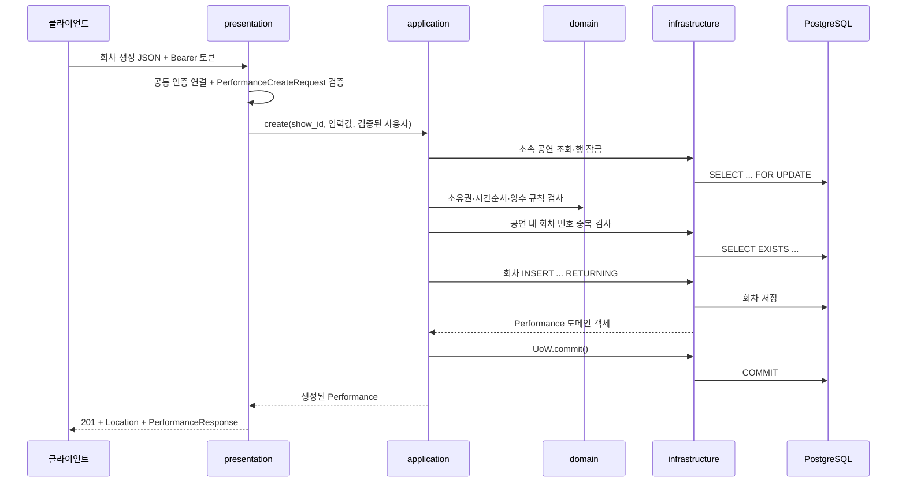

# 공연·공연회차 코드의 4계층 읽기

공연은 `shows`, 공연회차는 `performances` 폴더가 담당한다.
두 폴더 모두 같은 네 계층을 사용한다. 두 도메인이 함께 쓰는 규칙과 연결 계약은
`shared/domain`, DB 구현은 `shared/infrastructure`, HTTP 규칙은 `shared/presentation`에 둔다.

## 네 계층은 각각 무엇을 하는가

| 계층 | 이 코드에서 맡은 일 | 대표 파일 |
| --- | --- | --- |
| 표현 presentation | URL·Method·요청 형식 검증, 응답 필드·상태 코드·Location 헤더 | [공연 router](../src/asyncticket/shows/presentation/router.py), [회차 schemas](../src/asyncticket/performances/presentation/schemas.py) |
| 응용 application | 존재·권한·연결 데이터 확인의 순서를 조율하고 commit/rollback 결정 | [공연 service](../src/asyncticket/shows/application/service.py), [회차 service](../src/asyncticket/performances/application/service.py) |
| 도메인 domain | 공연/회차 데이터, 시간순서·값 규칙, 저장소·연결 조회 인터페이스 | [회차 객체](../src/asyncticket/performances/domain/performance.py), [값 검증](../src/asyncticket/shared/domain/catalog_validation.py), [저장소 계약](../src/asyncticket/performances/domain/repositories.py) |
| 인프라 infrastructure | SQLAlchemy 테이블 매핑, 실제 SQL 실행, DB 결과를 도메인 객체로 변환 | [공연 models](../src/asyncticket/shows/infrastructure/models.py), [회차 repositories](../src/asyncticket/performances/infrastructure/repositories.py) |

`models.py`는 DB 테이블 설명이고, `schemas.py`는 API 입출력 설명이다.
예를 들어 `shows.user_id`는 DB에 저장하지만 공개 `ShowResponse`에는 넣지 않는다.
생성 요청의 `user_id`도 받지 않는다. 검증된 로그인 사용자가 공연 소유자가 된다.

## 실제 폴더 구조

```text
src/asyncticket/
├── main.py                         # FastAPI 생성·라우터·예외 처리 등록
├── dependencies.py                 # DB 구현과 응용 서비스 연결
├── shows/
│   ├── presentation/               # router.py, schemas.py
│   ├── application/                # service.py
│   ├── domain/                     # show.py, repositories.py
│   └── infrastructure/             # models.py, repositories.py
├── performances/
│   ├── presentation/               # router.py, schemas.py
│   ├── application/                # service.py
│   ├── domain/                     # performance.py, repositories.py
│   └── infrastructure/             # models.py, repositories.py
└── shared/
    ├── core/                       # 팀 공통 Base·DB 세션·logger
    ├── domain/                     # 사용자·정책·값 검증·연결/UoW 계약
    ├── infrastructure/             # 연결 데이터 SELECT·UoW 구현
    └── presentation/               # 인증 연결·공통 오류·엄격한 날짜 형식
```

## 회차 등록 요청 하나를 따라가기

예: `POST /v1/shows/101/performances`



1. [회차 라우터](../src/asyncticket/performances/presentation/router.py)의
   `create_performance`가 URL의 `show_id`와 JSON을 받는다.
2. [요청 스키마](../src/asyncticket/performances/presentation/schemas.py)가
   필수 필드·정수·문자열 길이·시간대 포함 시각을 검사한다. `perf_id`나 `show_id`를
   본문에 몰래 추가하면 422다. `max_tickets_per_user` 생략 시 명세의 기본값 3을 사용한다.
3. [응용 서비스](../src/asyncticket/performances/application/service.py)가
   공연의 존재와 로그인 사용자의 변경 권한을 확인한다. 이때 부모 공연 행을 먼저 잠근다.
4. [도메인 규칙](../src/asyncticket/shared/domain/catalog_validation.py)이
   `booking_opens_at < booking_closes_at <= starts_at < ends_at`을 검사한다.
   이 함수는 FastAPI·SQLAlchemy 없이 호출할 수 있다.
5. [저장소 구현](../src/asyncticket/performances/infrastructure/repositories.py)이
   중복 여부를 조회하고 INSERT를 실행한다. DB 결과를 `Performance`로 바꿔 반환한다.
6. 응용 서비스가 `UoW.commit()`을 호출한다. 중간에 실패하면 `rollback()` 후 예외를 올린다.
7. 표현 계층이 `201`, `/v1/performances/{perf_id}`의 `Location`, 응답 JSON을 반환한다.

인프라의 UoW는 실제 `session.commit/rollback` 방법을 구현한다.
언제 확정하거나 되돌릴지는 응용 서비스가 결정한다. 저장소 자체는 commit하지 않는다.

저장소의 쓰기는 ORM 모델의 `__table__`로 SQLAlchemy Core의
`INSERT/UPDATE/DELETE`를 실행한다. `RETURNING`으로 DB가 생성한 ID·시각을 받고
도메인 객체로 바꾼다. 이 과정에서 외부 도메인의 ORM 모델을 임의로 정의하지 않는다.

## 계층 사이의 연결을 분리한 이유

서비스 생성자는 실제 DB 저장소 대신 `PerformanceRepository`라는 `Protocol`을 받는다.
Protocol은 “어떤 메서드가 필요하다”는 계약이다. 실제 구현을 정하는 곳은
[dependencies.py](../src/asyncticket/dependencies.py)다.

```text
응용 서비스 → 도메인의 저장소 계약
                      ↑ 구현
              SQLAlchemy 저장소 → DB
```

라우터와 서비스에 SQL을 직접 쓰지 않아 DB 처리와 비즈니스 규칙을 따로 읽을 수 있다.
공연회차 서비스가 공연 소유권을 확인할 때도 공연 인프라를 가져오지 않고
공연 응용 서비스의 `authorize_owner()`를 사용한다.

## PATCH를 읽을 때 주의할 점

- `{}`는 변경 필드가 없어서 422다.
- `description` 생략은 기존 값 유지, `description: null`은 내용 비우기다.
- `title: null`, `status: null`처럼 NOT NULL 필드에 null을 보내면 422다.
- `model_dump(exclude_unset=True)`가 생략과 null을 구분한다.
- 회차 시간 일부를 수정하면 기존 값과 합쳐 전체 시간순서를 다시 검사한다.
- 연결 좌석·예매가 있는 회차의 변경 제한은 현재 `CatalogPolicy` 적용값으로 관리한다.

## 오류는 어디에서 HTTP 응답이 되는가

도메인·응용에서는 `CatalogNotFoundError`, `CatalogForbiddenError`,
`CatalogConflictError`, `CatalogValidationError`를 발생시킨다.
[표현 계층의 오류 변환](../src/asyncticket/shared/presentation/catalog_http.py)이
각각 404·403·409·422와 `{detail: {code, message}}`를 만든다.

## 인증과 DB 검증 범위

[인증 연결](../src/asyncticket/shared/presentation/catalog_auth.py)은 Bearer 토큰을
공통 인증 모듈의 `authenticate(token)`에 전달한다. 서명을 직접 무시하거나 임의의
사용자 ID 헤더를 인증으로 취급하지 않는다. 토큰 없음/인증 실패는 401이고,
토큰은 있지만 공통 인증 모듈을 아직 연결하지 않은 상태는 503이다.

단위·API 테스트의 인증 구현과 SQLite는 테스트 전용이다. 실제 공통 인증과
PostgreSQL·다른 도메인 테이블 연결은 별도 통합 검증이 필요하다.
